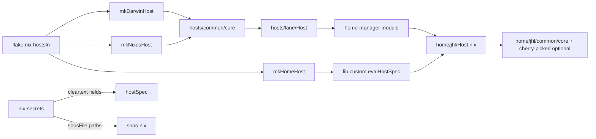

# Repository Guidelines

## Project Overview

A Nix flake for one user (`jhl`) across six machines on three lanes. Private data comes from the sibling `../nix-secrets`, a locked flake input.

| Lane | Host dir | Flake output | Machines |
|---|---|---|---|
| nix-darwin | `hosts/darwin/<Host>/` | `darwinConfigurations.<Host>` | `jhlsMacBookPro`, `jhlsMacBookAir`, `SeandeMac-Studio` |
| standalone home-manager | `hosts/home/<Host>/` | `homeConfigurations."jhl@<Host>"` | `jhlsRogZephyrus`, `jhlsTokyoDesktop` |
| NixOS | `hosts/nixos/<Host>/` | `nixosConfigurations.<Host>` | `DevEnv` |

Load the `nix-config` skill (`skills/nix-config/SKILL.md`) for any task here. Its `references/` hold the recipes (`recipes.md`), commands (`commands.md`), architecture (`architecture.md`), hostSpec fields (`hostspec.md`) and secrets rules (`nix-secrets.md`). `CLAUDE.md` only points here.

## Architecture & Data Flow



- **Host discovery:** `flake.nix` `hostsIn` lists the subdirectories of `hosts/{darwin,nixos,home}`.
- **Input pinning per lane:**
  - Darwin uses `nixpkgs-darwin` (26.05) with `home-manager` release-26.05. The unstable lib makes nix-darwin abort.
  - NixOS and standalone use `nixpkgs` unstable with `home-manager-unstable`.
- **Module order** is `[hosts/common/core, hosts/<lane>/<Host>, hm module]`. Core must come first, because `environment.systemPath` uses `mkOrder 1100`.
- **System chain:** `hosts/common/core/default.nix` imports `modules/common`, `modules/hosts/{common,<platform>}`, the per-platform core, `host-spec.nix`, `nix-settings.nix`, `sops.nix` and `users/jhl`.
  - `platform` comes from the `isDarwin` specialArg, never from hostSpec, which would cause infinite recursion.
- **Home wiring:** `hosts/common/users/jhl/{darwin,nixos}.nix` sets `useGlobalPkgs` and `useUserPackages`, passes `extraSpecialArgs = {inputs outputs isDarwin hostSpec}`, and imports `home/jhl/<Host>.nix`.
- **Standalone lane:** `mkHomeHost` builds `pkgs` itself (all overlays plus `allowUnfree`) and gets `hostSpec` from `evalHostSpec`. It has no system layer, so it skips `hosts/common/core` and has no `environment.systemPackages`.
- **hostSpec is the data bus.** It is defined in `modules/common/host-spec.nix` and filled from nix-secrets only in `hosts/common/core/host-spec.nix`.
- **Overlays** (`overlays/default.nix`):
  - Layers: `additions` (`pkgs/common`, currently empty), `customLib`, `modifications`, `linuxModifications`, `unstable-packages`.
  - Use `pkgs.unstable.<x>` to pull a package from unstable.
  - They are applied in `hosts/common/core/nix-settings.nix`.
- **omp/agent tooling:** `home/jhl/common/optional/ai/omp.nix` owns `~/.omp/agent/nix.yml` and `models.yml`. On activation it merges `modules/home/mcp-servers.nix` into `mcp.json` by key. `config.yml` and `mcp.json` stay writable by omp.

## Key Directories

| Path | Purpose |
|---|---|
| `lib/` | `lib.custom`: `relativeToRoot` (takes a **string**), `scanPaths`, `evalHostSpec` |
| `modules/` | Option modules, **auto-imported** via `scanPaths`: `common/` (hostSpec), `hosts/darwin/<feature>/`, `home/` (`sshKeys`, `llm`, `mcpServers`) |
| `hosts/common/core/` | Always-on system config, split by platform (`darwin.nix`, `darwin/`) |
| `hosts/common/optional/` | Opt-in system features. **Not auto-imported**; a host must list them |
| `hosts/common/users/jhl/` | User and home-manager wiring per platform |
| `home/jhl/common/core/` | Home config for every host. Reaches Linux, so darwin-only paths go in `darwin.nix`/`darwin/` |
| `home/jhl/common/optional/<cat>/` | Opt-in home features: `ai`, `desktop`, `editors`, `k8s`, `nix`, `shell`, `sops` |
| `home/jhl/<Host>.nix` | Per-host home entry |
| `skills/<name>/` | Agent skills, deployed to `~/.agents/skills/<name>` by `home/jhl/common/core/skills.nix` |
| `overlays/`, `pkgs/common/` | Overlay stack and custom packages (auto-picked) |
| `scripts/rebuild.sh` | Lane-aware switch. Calling it directly skips the just hooks |

## Development Commands

```sh
just rebuild            # switch the current machine (alias: just switch); runs rebuild-pre/post hooks
just build              # build without switching
just rebuild-trace      # with --show-trace
just rebuild-full       # rebuild, then check
just check              # nix flake check --all-systems; builds only the native lane. THE gate (no CI)
just fmt                # nix fmt (alejandra)
just deploy DevEnv      # remote NixOS deploy via nixos-rebuild-ng
just update             # flake update (+ brew on macOS)
just update-nix-secrets # pull ../nix-secrets and bump its lock
just diff               # git diff excluding flake.lock
nix develop             # dev shell (shell.nix: alejandra, deadnix, ...)
```

- `rebuild-pre` runs `update-nix-secrets`, `llm-models-soft` and `git add --intent-to-add .`. `rebuild-post` runs `check-sops` (darwin and NixOS).
- To evaluate without building:
  - darwin: `nix eval .#darwinConfigurations.<Host>.config.system.build.toplevel.drvPath`
  - NixOS: `nix eval .#nixosConfigurations.<Host>.config.system.build.toplevel.drvPath`
  - standalone: `nix eval .#homeConfigurations.\"jhl@<Host>\".activationPackage.drvPath`
- To read a generated file: `nix build .#darwinConfigurations.<Host>.config.home-manager.users.jhl.xdg.configFile."<path>".source`, then `cat result`.
- User-only recipes are `age-key`, `rekey`, `sops-edit` and `verify-sops`. **Never run them.**

## Code Conventions & Common Patterns

- **Formatting:** alejandra. Check with `nix run nixpkgs#alejandra -- --check <files>`.
- **Language:** everything is in English. One exception: the `msd` replacement in `home/jhl/common/core/darwin/keyboard.nix` is user data; do not translate it.
- **File header:** a `####` banner comment after the argument set, stating purpose and consumer.
- **Option modules:**
  - Use a platform-prefixed camelCase namespace (`darwinOmni`, `darwinYubikey`, `darwinHomebrew`, `darwinWallpaper`).
  - Each lives in `modules/hosts/<platform>/<feature>/default.nix`.
  - Code shape: `cfg = config.<ns>;` then `config = lib.mkIf cfg.enable { ... }`.
- **hostSpec access:**
  - System modules read `config.hostSpec.<x>`.
  - Home modules destructure `{ hostSpec, ... }`.
  - Never read `inputs.nix-secrets.<x>` directly. The only exceptions are `sopsFile = "${inputs.nix-secrets}/secrets/<f>.yaml"` and the `agents/AGENTS.md` store path.
- **Host files** set `hostSpec.hostName` plus flags, and import optionals with `map lib.custom.relativeToRoot ["hosts/common/optional/<p>.nix"]`.
  - `hostName` must equal the directory name and `home/jhl/<Host>.nix`.
  - `hosts/home/<Host>/default.nix` may set **only** `hostSpec`.
- **Priorities:** `lib.mkDefault` in shared layers, plain assignment in hosts.
- **Missing-secret guard** (pattern: `hosts/common/optional/darwin/npmrc.nix`, `modules/hosts/darwin/omni/default.nix`):
  - Assert `builtins.pathExists sopsFile && lib.hasInfix "<parent>:\n    <child>:" (builtins.readFile sopsFile)`.
  - Write the message in English, naming the key, the file and the fix (`just sops-edit shared`, push nix-secrets, `just update-nix-secrets`).
- **MCP servers:** HTTP servers are one line in `modules/home/mcp-servers.nix` (`<name>.url = "...";`). For stdio servers, set `omp.mcpServers.<name>` in an `optional/ai/<name>-mcp.nix` (example: `blender-mcp.nix`).
- **Commits:** Conventional Commits with a scope, e.g. `feat(darwin): ...` or `refactor(skills): ...`. Write subjects only.

## Important Files

- `flake.nix`: inputs, the `mkDarwinHost`, `mkNixosHost` and `mkHomeHost` builders, `checks`, `formatter`, and substituters (`nixConfig`).
- `justfile`, `scripts/rebuild.sh`, `shell.nix`
- `modules/common/host-spec.nix`: hostSpec schema (`freeformType = attrsOf str`) and assertions.
- `hosts/common/core/host-spec.nix`: copies identity data from nix-secrets into hostSpec.
- `hosts/common/core/sops.nix`, `home/jhl/common/optional/sops/standalone.nix`: system and standalone secrets.
- `modules/hosts/darwin/homebrew/default.nix`: brew bundle with `cleanup = "zap"`.
- `home/jhl/common/optional/ai/omp.nix`, `modules/home/mcp-servers.nix`: omp config and MCP servers.
- `home/jhl/common/core/skills.nix`: skill deployment.
- `../nix-secrets/.sops.yaml`: recipients. It lives outside this repo and is user-operated.

## Runtime/Tooling Preferences

- **Nix only.** Never install tools system-wide (brew, pip, `npm -g`, `curl | sh`). Recipes use `nix run nixpkgs#<tool>` or `nix shell`.
- **Homebrew is declarative.** Removing a brew from Nix uninstalls it, and a manual `brew install` is temporary. `masApps` go through `mas.nix`.
- **JS:** use `bun`/`bunx`.
- **Private SSH inputs** (`nix-secrets`, `jianyuelab-docs`, `jianyuelab-plugins`): `just check` and evaluation need GitHub SSH auth.
  - Local edits to those repos are invisible until they are pushed and their lock is bumped (`just update-nix-secrets`, `nix flake update jianyuelab-docs`). Say so explicitly when a change depends on one.
- **Secrets are user-operated.**
  - Never run `sops`, `just rekey` or `just age-key`.
  - Never edit `.sops.yaml` or anything under `../nix-secrets/secrets/`.
  - Write the Nix that references `sops.secrets."<path>"`, state the YAML key and file, then stop. A secret that does not exist yet also gets the missing-secret guard below.
- **Scratch files** go in `.temp/` (gitignored), never `/tmp`.
- **Never manage self-writing files** through `home.file`/`xdg.configFile`: Claude Code `settings.json`, omp `config.yml`/`mcp.json`, Zed UI settings.

## Testing & QA

- There are no unit tests and no CI. Verification has three parts:
  - **Evaluation:** `nix eval ...drvPath` on every lane you touched.
  - **Gate:** `just check` on the native system. It builds `darwin-<Host>` on aarch64-darwin, and `nixos-<Host>` plus `home-jhl-at-<Host>` on x86_64-linux. A Mac never builds the Linux lanes.
  - **Assertions:** evaluation-time guards for hostSpec invariants, missing sops keys and dependency invariants.
- **New files must be tracked:** run `git add --intent-to-add .` first. Untracked files are invisible to the flake, which still evaluates cleanly and silently ignores them.
- **Formatting is not part of `just check`.** Run `just fmt` or alejandra `--check` yourself. `deadnix` is available in `nix develop` but no recipe or check runs it.
- `just check-sops` (automatic, darwin and NixOS) confirms declared secrets are non-empty in `/run/secrets`.
- `just verify-sops` is an end-to-end canary, darwin only. It needs `sops-canary.nix` restored from git history.
- **Silent failure modes:**
  - An optional file that no host imports does nothing.
  - `relativeToRoot` given a path literal fails.
  - Writes through the `/run/secrets` symlinks are wiped at activation.
  - Removing a key from `programs.zed-editor` settings leaves it in `settings.json` (`mutableUserSettings` is a one-way merge).
  - `hosts/home/<Host>/default.nix` is not a module: it is `evalModules`'d against `modules/common/host-spec.nix` alone. Keep `hosts/common/core/host-spec.nix` free of `imports` and other options for the same reason.
  - `home/jhl/common/core/*.nix` reaches Linux. Darwin-only paths (`/opt/homebrew`, `/etc/profiles/per-user`, `launchd`, `targets.darwin`) go in `common/core/darwin.nix` or `common/core/darwin/`.
  - A new skill under `skills/<name>/` needs intent-to-add and a rebuild before it deploys.
