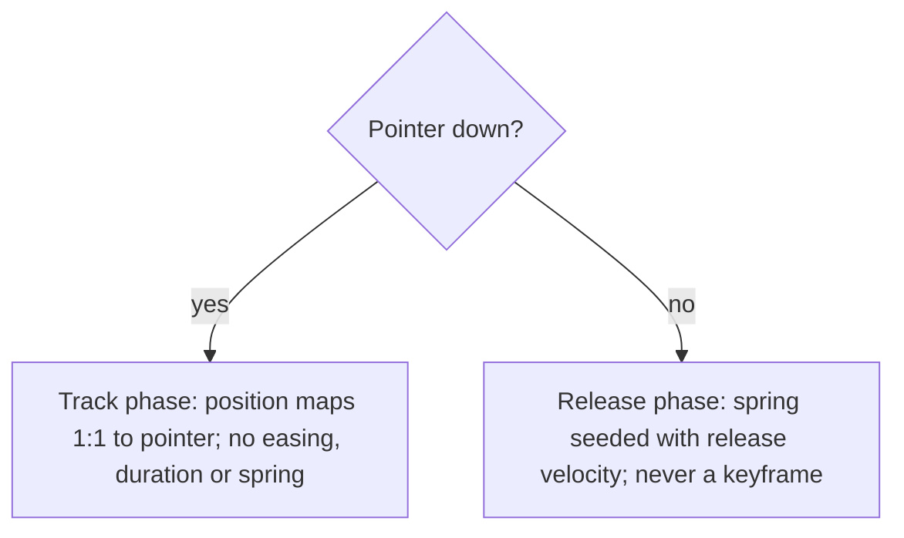

# Apple Design

## Overview

An interface feels physical when motion starts from the current on-screen value, inherits the user's velocity, projects momentum forward, and can be grabbed and reversed at any instant. A gesture has two phases: while the pointer is down the UI *is* the finger; once it lifts, physics (a spring) finishes the motion.

Source: Apple WWDC talks — *Designing Fluid Interfaces* (2018), *Designing Audio-Haptic Experiences*, *The Details of UI Typography* (2020), *Principles of Great Design* (2026) — translated to CSS, Pointer Events, `requestAnimationFrame` and Motion / Framer Motion.

## When to Use

- Building or fixing anything dragged, swiped, flung, held or dismissed by gesture.
- A gesture trails the finger, jumps on release, ignores flicks, or can't be caught mid-flight.
- Choosing spring parameters for touchable UI.
- Translucent chrome, depth, Apple-style typography, multimodal feedback, design-principle review.

**Build or use a library:** a correct drawer needs momentum dragging, overlay opacity tied to drag progress, velocity-aware dismissal, focus trapping and Escape-to-close. For a bottom sheet / drawer default to [Vaul](https://vaul.emilkowal.ski/). Hand-roll only interactions no library covers (custom swipe cards, bespoke drag).



## Core Pattern

| Wrong | Right |
|---|---|
| Spring or transition drives position during drag (element trails the finger) | `useMotionValue` or direct `transform` writes, 1:1 |
| Snap element center to pointer on grab | Keep the grab offset |
| Fixed-duration ease on release (every fling lands the same) | Spring with the release velocity |
| Dismiss on distance only (flicks ignored) | Distance **or** velocity |
| Snap to nearest point from release position | Project momentum, snap to nearest the projection |
| New animation starts from target value (jump) | Start from the live presentation value |
| CSS `@keyframes` on gesture-touchable UI (restarts from zero, can't be caught) | Springs or CSS transitions |
| Overlay fade animated separately (drifts on interrupt) | Derived from drag progress with `useTransform` |
| Hard stop at boundary | Rubber-band |
| Bounce on a button-triggered close | Bounce only after a drag release |

```jsx
const y = useMotionValue(0);
const overlayOpacity = useTransform(y, [0, drawerHeight], [1, 0]);

<motion.div
  drag="y"
  dragConstraints={{ top: 0 }}
  dragElastic={0.2}
  onDragEnd={(e, info) => {
    if (info.offset.y > threshold || info.velocity.y > 500) dismiss();
  }}
/>
```

- `dragMomentum` is on by default: right for a flung card; disable it when the element should stop where the finger stops.
- `dragConstraints` takes a ref or a bounds object.

## Quick Reference

### Springs

Apple uses two parameters instead of mass/stiffness/damping:

- **Damping ratio** — `1.0` critically damped (no overshoot); `< 1.0` overshoots; lower = bouncier.
- **Response** — seconds to reach the target; lower = snappier. Not a duration: settle time emerges from the parameters.

| Interaction | Damping | Response |
|---|---|---|
| Default UI | `1.0` | `0.3–0.4` |
| Move / reposition (PiP) | `1.0` | `0.4` |
| Rotation | `0.8` | `0.4` |
| Drawer / sheet | `0.8` | `0.3` |
| After a flick / throw / drag release | `~0.8` | `0.3–0.4` |

- Bounce only when the gesture carried momentum; a button-triggered close gets zero bounce.
- Bounce scales inversely with element size: smaller elements need more to read the same.
- A spring that feels "weird" usually needs more damping.
- Motion's `bounce` + `duration` maps closely to damping + response.

```js
import { animate } from 'motion';
animate(el, { y: 0 }, { type: 'spring', bounce: 0, duration: 0.4 });        // default
animate(el, { y: target }, { type: 'spring', bounce: 0.2, duration: 0.4 }); // after a flick
```

### Values

| Need | Value |
|---|---|
| Edge resistance (Motion) | `dragElastic` ≈ `0.2` |
| Dismiss distance threshold | ~40–50% of travel, or fast flick (`info.velocity` > ~500 px/s) |
| Direction-commit hysteresis | ~10px movement before locking an axis |
| Tap hit padding | ~10px hysteresis around the target |
| Hit target | ≥ 44×44px; enlarge with an invisible `::before` |
| Projection deceleration | `0.998` normal scroll feel, `0.99` snappier |
| Vaul iOS sheet curve | `cubic-bezier(0.32, 0.72, 0, 1)` over 500ms |
| Small floating drawer | 200ms `cubic-bezier(0.165, 0.84, 0.44, 1)` |
| Press feedback | `scale(0.97)`, 100ms `ease-out` on `:active` |
| Reverse vs commit | velocity **sign** at release, not position |

## Implementation

### 1. Response

Directness collapses as soon as lag appears.

- Respond on pointer-down: highlight on press, commit on release. Never wait for `click` to show feedback.
- Audit every latency on the input path: debounces, artificial timers, transition waits, the ~300ms tap delay.
- Feedback is continuous during the interaction (drag, slider, drawer), never only at completion.

```css
.button:active { transform: scale(0.97); transition: transform 100ms ease-out; }
```

### 2. Track phase

- Pointer Events with `setPointerCapture` so tracking continues outside the element; respect the grab offset.
- Keep a short position + timestamp history of recent `pointermove` events to compute release velocity.
- Write `transform` on the dragged element itself. Never move children via a CSS variable on a parent: variables inherit, so each change restyles all descendants (this made Vaul laggy past ~20 list items).
- No React state per move event; motion values and direct style writes bypass rendering.

```js
el.addEventListener('pointerdown', (e) => {
  el.setPointerCapture(e.pointerId);
  const grabOffset = e.clientY - el.getBoundingClientRect().top;
  // track position + timestamp history for velocity
});
```

### 3. Rubber-banding

Resistance grows the further past the bound; a hard stop reads as frozen.

```js
function rubberband(overshoot, dimension, constant = 0.55) {
  return (overshoot * dimension * constant) / (dimension + constant * Math.abs(overshoot));
}
```

### 4. Release: velocity handoff

The spring continues at the finger's exact velocity so there is no seam. Motion takes absolute px/s (`velocity` option). APIs wanting relative velocity:

```
relativeVelocity = gestureVelocity / (targetValue − currentValue)
```

Element at `y=50`, target `y=150`, finger at 50px/s → `50 / 100 = 0.5`.

Snap-back after a missed threshold is fast; a slow snap-back reads as the UI disagreeing.

### 5. Momentum projection

Apple's projection (from the *Designing Fluid Interfaces* sample code). Not the textbook `v²/(2·decel)`. Used by Vaul and Embla.

```js
function project(initialVelocity /* px/s */, decelerationRate = 0.998) {
  return (initialVelocity / 1000) * decelerationRate / (1 - decelerationRate);
}
const target = nearestSnapPoint(currentPosition + project(releaseVelocity));
animateSpringTo(target, { velocity: releaseVelocity });
```

### 6. Interruptibility

- Never lock out input during a transition; a closing sheet the user grabs follows the finger.
- On interrupt, read the live on-screen transform and animate from there.
- Retargeted springs keep their velocity; replacing one animation with another at a reversal creates a velocity "brick wall". Pick a spring library that retargets from current velocity (iOS does this with additive animations).
- CSS `@keyframes` restart from zero: Sonner's early CSS enter animation made toasts jump when a second toast arrived.
- Decompose 2D motion into independent X and Y springs.

### 7. Linked values

Overlay fade, background scale and similar values derive from drag progress (`useTransform`, see Core Pattern). One source of truth stays correct mid-gesture and on reversal.

### 8. Sheets with CSS: the Vaul curve

`cubic-bezier(0.32, 0.72, 0, 1)` over 500ms is steep at the start, so it feels snappy and settles like a spring. The 500ms timing only fits a full-width, edge-attached sheet. Small floating drawers:

```css
[vaul-drawer]  { transition: transform 0.2s cubic-bezier(0.165, 0.84, 0.44, 1); }
[vaul-overlay] { transition: opacity  0.2s cubic-bezier(0.165, 0.84, 0.44, 1); }
```

- Height changes and content crossfades share the drawer's timing family; one slow sub-animation breaks the single-entity feel.
- Mark interactive children `data-vaul-no-drag` so pressing them doesn't start a drag.

### 9. Spatial consistency

- Enter and exit along the same path; dismiss in the direction of entry (Sonner toast enters from the bottom, swipe down dismisses).
- Anchor popovers, menus and sheets to their trigger with `transform-origin`.
- Mirror easing on reversible transitions (inverse cubic-bézier control points).
- Hint toward the outcome: intermediate frames point at the final state (Control Center modules grow up and out toward the finger).

### 10. Gesture recognition

- Tap: allow cancel by dragging away and back.
- Detect all plausible gestures in parallel from the first move, cancel the losers once intent is clear. Avoid recognizers that only report a final state (`swipeleft`-type events).
- Double-tap detection delays single taps; pay it only where double-tap exists.
- Hold gestures are asymmetric: `linear` during the hold (it visualizes time), fast `ease-out` snap-back on early release.

### 11. Touch checklist

- Test on a real phone via the dev server's local IP; trackpads lie about touch, and 60Hz monitors hide roughness a 120Hz phone shows.
- `touch-action` on the free axis (`pan-x` for a vertical drag) so native scrolling doesn't fight the gesture.
- Gate hover behind `@media (hover: hover) and (pointer: fine)`; touch fires phantom hovers.
- Diagnose a feel you can't name by recording the gesture and scrubbing frame by frame. Stutter is a performance problem: see animation-performance.

### 12. Frame-level smoothness

- Keep per-frame positional change below the perception threshold to avoid strobing.
- Very fast motion: a subtle motion blur / stretch encodes speed.
- `requestAnimationFrame` is the display-synced clock (Apple: `CADisplayLink`). Animate `transform` and `opacity`; `will-change` where motion is imminent.

### 13. Materials and depth

- Nav, toolbars and sheets as translucent layers (`backdrop-filter: blur()` + semi-transparent background) with content scrolling underneath.
- Heavier/darker materials separate structure (sidebars); lighter ones mark interactive elements. Never stack light translucent on light translucent.
- Larger surfaces read thicker: stronger blur, deeper shadow. Heavier shadow over busy content, lighter over plain.
- Modal task: dimming scrim, background pushed back. Parallel panel: translucency and offset, no scrim. Stacked sheets: dim and push back each parent.
- Text over translucency: higher contrast, slightly heavier weight, small letter-spacing bump, no flat gray. Color goes on a solid layer.
- Sticky header: fade a blur/gradient mask where content meets floating chrome instead of a 1px divider, only where they overlap.
- Glass enter/exit animates blur radius and scale together, not opacity alone.

```css
.toolbar {
  background: rgba(255, 255, 255, 0.6);
  backdrop-filter: blur(20px) saturate(180%);
  border-top: 1px solid rgba(255, 255, 255, 0.4);
}
```

For glass surface styling see glassmorphism.

### 14. Multimodal feedback

1. **Causality** — fire on the causal event (toggle flips, item snaps home); match character to the action.
2. **Harmony** — visual, sound and haptic (Vibration API) on the same frame; no CSS transition lag.
3. **Utility** — only for meaningful moments (success, error, commit, snap).

### 15. Reduced motion and accessibility

Tracking is user-produced motion and stays. Reduce momentum flings, bounce and decorative motion; settle with a short opacity/position change instead of a bouncy spring.

| Signal | Response |
|---|---|
| `prefers-reduced-motion: reduce` | Short opacity cross-fades instead of slides/springs/parallax; no overshoot; keep comprehension-aiding opacity/color |
| `prefers-reduced-transparency: reduce` | Raise background opacity, drop blur |
| `prefers-contrast: more` | Near-solid backgrounds, contrasting border |

Also avoid full-viewport moving backgrounds, slow loops near 0.2 Hz (one cycle per 5s) and abrupt brightness jumps (ease theme changes). Make large moving objects semi-transparent in transit; fade big surfaces out during large repositions.

```css
@media (prefers-reduced-motion: reduce) {
  .sheet { transition: opacity 200ms ease; transform: none !important; }
}
@media (prefers-reduced-transparency: reduce) {
  .toolbar { background: white; backdrop-filter: none; }
}
```

Full reduced-motion work: see accessible-animation.

### 16. Typography

- Tracking is size-specific: negative on large display text (`-0.02em`), slightly positive on small text, body near `0`.
- Leading scales inversely with size: tight headings, looser body; looser for tall-ascender scripts, tighter for dense UI.
- Hierarchy from weight + size + leading together; emphasize with weight.
- Respect user text size: spacing in `rem`/`em`.
- Default to the system font (optical sizing and tracking tables built in).

```css
:root { font: 100%/1.5 system-ui, sans-serif; }
.display {
  font-size: clamp(2rem, 5vw, 4rem);
  line-height: 1.05;
  letter-spacing: -0.02em;
  font-optical-sizing: auto;
}
```

### 17. Design principles

Apple's eight (*Principles of Great Design*):

1. **Purpose** — decide what not to build; every feature spends the user's time, attention and trust.
2. **Agency** — offer choices; easy undo for slips; confirmation dialogs only for destructive, irreversible actions (overuse trains click-through).
3. **Responsibility** — ask for permissions at the right moment, only what's needed; anticipate misuse, especially with AI (an allergy-aware recipe app must not suggest a harmful ingredient); add previews, confirmations, disclaimers; cut features whose risk outweighs value.
4. **Familiarity** — metaphors neither too literal nor too abstract (trash can = delete), honoring their physics; same look = same behavior and place (close is top-left on macOS); break a pattern only when proven better by testing.
5. **Flexibility** — adapt to platform (iPhone quick touch; desktop deep workflows, precise pointer) and to age, language, expertise, accessibility; allow personalization when no layout fits all.
6. **Simplicity, not minimalism** — plain language, fewer steps, hierarchy via order, spacing, contrast; adding context can simplify (scrubber showing time remaining); common path first, advanced one level deeper.
7. **Craft** — every spacing, timing and alignment value is defensible; jittery scroll, misaligned icons, layouts breaking on rotation read as carelessness; keep iterating.
8. **Delight** — the result of the other seven; choose the target emotion (calm, confident, excited) and reinforce it.

Tactical rules:

- Feedback has four kinds: status, completion, warning, error. Validate inline, not on submit.
- Wayfinding: every screen answers where am I, where can I go, what's there, how do I get out.
- Proximity implies relationship; place controls near and mirroring what they change. Needing a label signals weak mapping.
- Specific labels ("Progress", "Library") beat generic ones ("Home").

### 18. Process

- Prototype interactively; a working demo sets the bar for the final build.
- Design interaction and visuals together.
- Test with real people in context; review motion in slow motion / frame by frame.

## Common Mistakes

| Mistake | Fix |
|---|---|
| Hand-rolling a bottom sheet | Vaul |
| Mixing track and release phases | Track 1:1, release with a velocity-seeded spring |
| Feedback only on `click` / gesture end | Pointer-down, continuous |
| CSS variable on parent moves children | `transform` on the element |
| `setState` per `pointermove` | Motion values / direct style writes |
| Single spring on a 2D distance | Independent X and Y springs |
| Slow snap-back | Fast spring |
| Symmetric hold/cancel timing | `linear` hold, fast `ease-out` cancel |
| Dismiss axis differs from entry axis | Reverse the entrance |
| 500ms Vaul curve on a small floating drawer | 200ms override |
| Button inside drawer starts a drag | `data-vaul-no-drag` |
| Native scroll fights the drag | `touch-action` |
| Testing only with a trackpad | Real phone via local IP |
