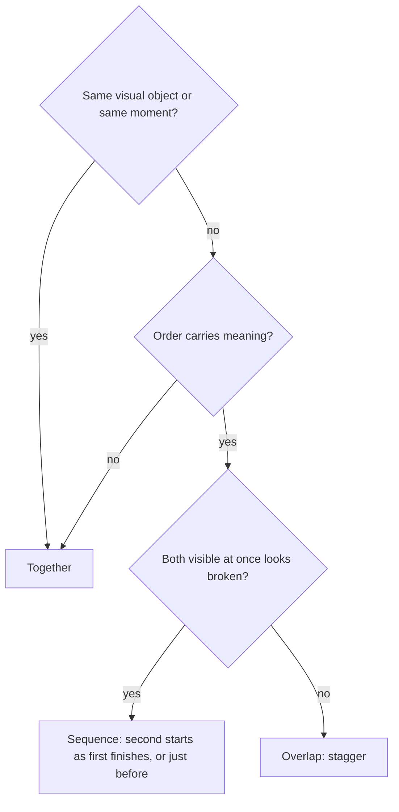

# Choreographing Motion

## Overview

Choreography decides the relationships between animations: order, overlap, timing and stillness. Good choreography mostly cuts moving parts and runs the rest in parallel; sequence only when order carries meaning (reading order, cause and effect, one thing physically arriving before another). A good sequence reads as one gesture, a wave; a bad one reads as a queue.

## When to Use

- Two or more things move in response to the same event.
- A single animation's easing, duration and origin: animate.
- Whether something should animate at all: improve-animations.

## Core Pattern

| Before (adding) | After (choreographed) |
|---|---|
| Panel slides in, then its items trickle in | Panel slides; items are already there |
| Every child `delay: i * 0.1` | 30–80ms steps, non-uniform, total ≲300ms, first handful only |
| Old view exits, new view waits (`mode="wait"`) | Crossfade with `popLayout` |
| Leaving item fades, then gap closes | Item leaves layout at once; siblings slide while it fades |

## Quick Reference

### Hard rules

1. **One entrance per container.** Never animate a parent's entrance *and* stagger its children.
2. **No stagger on high-frequency or keyboard-triggered UI.** Dropdown items, menu rows, command palettes, tab content and list rows opened many times a day appear together or without animation.
3. **No uniform stagger.** Same delay, distance, duration and easing for every item moves like a metronome — the group equivalent of `linear`. Vary timing by importance.
4. **Never block interaction.** Everything visible is clickable; a delayed item must not hold back a button the user is reaching for.
5. **Every sequence survives interruption** (see Interruption).

### Budgets

| Context | Stagger step | Entrance | Total |
|---|---|---|---|
| Product UI | 30–80ms | — | ≲300ms; stagger only the first handful, rest arrive with the last |
| Marketing / first-run / hero | 100–150ms | 0.5–0.6s | seen once per visit |

## Implementation

### Step 1 — Cast the elements

List every element that moves on the event and give each a role before writing any timing:

| Role | What it is | Treatment |
| --- | --- | --- |
| **Lead** | The one thing the user must notice: the title, the new view, the item acted on | Moves first, travels most, stays on screen longest |
| **Support** | Secondary content: subtitle, CTAs, the rest of the list | Follows with shorter, smaller motion |
| **Decoration** | Pills, badges, background accents, dividers | Fades only, or nothing |
| **Static** | Everything else, including containers whose content animates | Doesn't animate |

More than one lead is a hierarchy problem motion can't solve; say so. Most groups shrink here: a side panel with eight menu items becomes one move.

### Step 2 — Pick the relationship for each pair

**Carry** is a fifth option: when you can't control a child's motion directly (shared layout / `layoutId`), animate the **parent** and let the children come along. Images flying into a trash can drop *into* it because their container moves.

#### Together, by default

- **A leaving element stops taking space immediately**, so siblings slide into the gap *while* it fades. Motion: `AnimatePresence mode="popLayout"`. No library: set the exiting element to `position: absolute` at its current position before animating it out.
- **Swapping views in one container is a crossfade** — `popLayout`, not the default mode, which renders the two views one after the other.
- **Sub-animations of one component share a timing family.** A drawer that opens in 500ms then resizes in 200ms reads as two objects; use one duration. Inner animations may use a *lighter* curve (slower content fade) but the same easing family: an `ease-in-out` body inside an `ease-out` container feels out of sync. Set the family once with `MotionConfig` or one shared CSS custom property.

#### Overlap: the stagger

- Never let item 20 wait 20× the delay.
- **Order follows importance, not DOM order.** Consider putting title and first paragraph on one beat (both step 0).
- **Vary treatment as well as delay.** Lead slides furthest, support less, decoration fades in place. Shrinking delays (or easing applied to delays) read as organic; equal gaps read as mechanical.
- **Direction follows reading direction or the cause**: top to bottom for content, outward from the point of interaction for user-triggered things.

#### Sequence: when to wait

- **Two rich states in a container changing size in both dimensions** (Dynamic Island-style width *and* height): old content leaves before new starts (`mode="wait"`). For a crossfade anyway, use the duplicate-view technique in [RECIPES.md](RECIPES.md).
- **One element would visibly pass through another**: items flying into a container whose front face is drawn above them — show the front only when they've almost landed. Use a delay, not a full sequence.
- **Drawing with cause and effect**: checkbox square draws, *then* the checkmark. Second delay = first duration; both need `forwards` (or `both`) to hold the end state.

Start the second move just before the first ends; that turns a queue into one gesture.

### Step 3 — Sync secondary motion to the moment that matters

Each supporting animation hooks onto the lead's start, impact or settle — not a delay that looks about right.

- **Sync to the cause.** In hover-then-click, the background pulses *on the click*, with the press, not on hover.
- **Land accents with the lead.** Motion lines or sparkles complete as the main shape finishes: a burst in the last ~20% (`times: [0.7, 0.9]`), most important line first, others ~40ms behind.
- **Repeat actions skip the buildup.** With hover already in place, a click plays immediately: no background delay, morph starts earlier. Keep internal proportions; shift everything earlier.

### Step 4 — Adapt timing to what changed

- **Scale duration by distance.** Derive from the delta and clamp: `clamp(0.15s, Δheight / 500, 0.27s)`. A tiny jump with the full fade looks like a flicker. See RECIPES.md.
- **Scale bounce by size.** Small elements need more bounce; a large view with the same bounce settles slower and looks heavier. Tune per state.
- **Few states: hardcode values per transition.** A dozen hand-tuned transitions beat a formula; use a formula only when there are too many states.

### Step 5 — Direction and exits

- **Forward moves content left** (new enters from the right); back moves it right. Content switching between sibling menus enters from the side of the trigger the user came from.
- **Exits read state when they start**: pass direction through `custom` on both `AnimatePresence` and the child.
- **Exits are simultaneous, shorter, simpler.** No reverse stagger on close.
- **An exit matches its entry.** Slid in from the right → leaves toward the right.

### Interruption

- **Re-trigger mid-sequence**: hover out halfway, click Next twice fast, switch menus mid-open. Stop in-flight animations before starting new ones; never stack.
- **Wait for completion before chaining.** An idle loop resuming after hover-out starts only after *all* reset animations finish (`await Promise.all(...)`).
- **Gate actions on completion with a `useRef` boolean**, not state — the flag never renders.
- **Rapid view switching** with `AnimatePresence` can leave two children mounted; check it, and give each child a stable, unique `key`.

### Attention loops

Idle animations that invite interaction (a hand that taps, an icon that wiggles) wait ~2.5s before the first run, repeat rarely (`repeatDelay` ~6s), stop while the user interacts, and resume only after the interaction's reset finishes.

### Reduced motion

Collapse the choreography, don't shorten it: under `prefers-reduced-motion: reduce` drop delays and movement, keep opacity, show the group together. If the sequence *is* the explanation (step-by-step illustration), jump between frames. Tiering details: accessible-animation.

### Tools

Use the lightest tool that expresses the relationships; recipes in [RECIPES.md](RECIPES.md).

| Tool | Use for |
|---|---|
| CSS: `--index` per item × delay variable, keyframe with `animation-fill-mode: both` (delayed items don't flash their final state) | One-shot entrances |
| Motion variants: `delayChildren: stagger(...)` on the parent; `stagger` takes `from` and `ease` for non-uniform delays | Groups entering/exiting with React state |
| Motion `useAnimate` (imperative) | Several elements across several events (hover, click, idle timer) needing awaited completion; much harder to maintain, not for a simple stagger |

### Workflow

1. **Inventory** every element that moves on the event, with `file:line`.
2. **Cast** roles; remove movement from everything not Lead or Support.
3. **Relate** each pair (Together / Overlap / Sequence / Carry) and record why.
4. **Write the timeline** before coding; check budgets.
5. **Implement** with the lightest tool.
6. **Verify**: record the interaction and step frame by frame — a wave and a queue look alike at full speed in your head. Run the interruption checks. Imagine the 50th use of the day; if you'd skip it, cut it.

### Output format

**Part 1 — Timeline**, one row per moving element in start order:

| Element | Role | Starts | Duration | Motion | Relationship |
| --- | --- | --- | --- | --- | --- |
| Title | Lead | 0ms | 600ms | fade + 12px rise | — |
| Subtitle | Support | 80ms | 500ms | fade + 8px rise | Overlaps title |
| CTAs | Support | 140ms | 500ms | fade + 6px rise | Overlaps subtitle |
| Pill | Decoration | 0ms | 400ms | fade only | Together with title |
| Background | Static | — | — | — | — |

**Part 2 — What doesn't move**: 2–5 elements with motion removed, each with its reason ("Menu items: one entrance per container, the panel carries them").

**Part 3 — Feel check**: what code can't show (does the stagger read as a wave, the crossfade as one object); name the moment to scrub on a recording.

Talk in relationships and moments ("the lines land with the click"), not adjectives. When a sequence is fine, or the right choreography is none, say so.

## Common Mistakes

| Mistake | Fix |
|---|---|
| Parent entrance plus child stagger | One entrance; the container carries its content |
| `mode="wait"` for a simple view swap | `popLayout` crossfade |
| Exit direction from stale state | `custom` on `AnimatePresence` and child |
| Reverse-staggered exits | Everything leaves at once |
| Fixed duration for variable-size resize | Clamp duration from the delta |
| Idle loop fighting a reset | `await Promise.all(...)` of the reset first |
