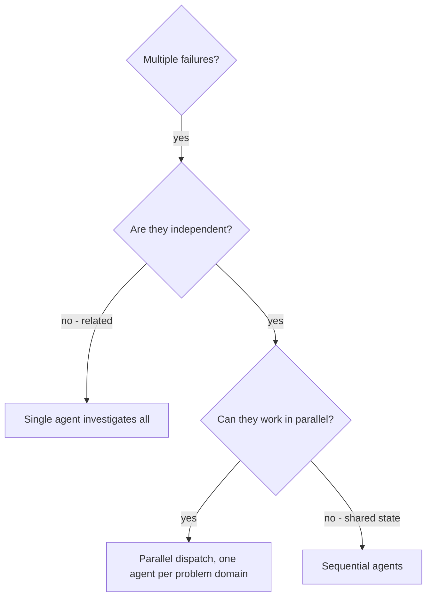

# Dispatching Parallel Agents

## Overview

Each agent gets isolated context crafted for its task — never your session's history — which keeps it focused and preserves your own context for coordination.

When you have multiple unrelated failures (different test files, different subsystems, different bugs), investigating them sequentially wastes time. Each investigation is independent and can happen in parallel.

**Core principle:** Dispatch one agent per independent problem domain. Let them work concurrently.

## When to Use



**Use when:**
- 3+ test files failing with different root causes
- Multiple subsystems broken independently
- Each problem can be understood without context from others
- No shared state between investigations

**Don't use when:**
- Failures are related — fixing one might fix others; investigate together first
- Understanding requires seeing the entire system
- Exploratory debugging — you don't know what's broken yet
- Shared state — agents would interfere (editing the same files, using the same resources)

## The Pattern

### 1. Identify Independent Domains

Group failures by what's broken:
- File A tests: Tool approval flow
- File B tests: Batch completion behavior
- File C tests: Abort functionality

Each domain is independent - fixing tool approval doesn't affect abort tests.

### 2. Create Focused Agent Tasks

Each agent gets:
- **Specific scope:** One test file or subsystem
- **Clear goal:** Make these tests pass
- **Constraints:** Don't change other code
- **Expected output:** Summary of what you found and fixed

### 3. Dispatch in Parallel

Dispatch all three subagents at once, then wait for their results:

```text
Dispatch a subagent: "Fix agent-tool-abort.test.ts failures"
Dispatch a subagent: "Fix batch-completion-behavior.test.ts failures"
Dispatch a subagent: "Fix tool-approval-race-conditions.test.ts failures"
# All three run concurrently.
```

### 4. Review and Integrate

When agents return:
1. **Review each summary** — understand what changed.
2. **Check for conflicts** — did agents edit the same code?
3. **Run the full suite** — verify all fixes work together.
4. **Spot check** — agents can make systematic errors.
5. Integrate all changes.

## Agent Prompt Structure

Good agent prompts are:
1. **Focused** - One clear problem domain
2. **Self-contained** - All context needed to understand the problem
3. **Specific about output** - What should the agent return?

```markdown
Fix the 3 failing tests in src/agents/agent-tool-abort.test.ts:

1. "should abort tool with partial output capture" - expects 'interrupted at' in message
2. "should handle mixed completed and aborted tools" - fast tool aborted instead of completed
3. "should properly track pendingToolCount" - expects 3 results but gets 0

These are timing/race condition issues. Your task:

1. Read the test file and understand what each test verifies
2. Identify root cause - timing issues or actual bugs?
3. Fix by:
   - Replacing arbitrary timeouts with event-based waiting
   - Fixing bugs in abort implementation if found
   - Adjusting test expectations if testing changed behavior

Do NOT just increase timeouts - find the real issue.

Return: Summary of what you found and what you fixed.
```

## Common Mistakes

**❌ Too broad:** "Fix all the tests" - agent gets lost
**✅ Specific:** "Fix agent-tool-abort.test.ts" - focused scope

**❌ No context:** "Fix the race condition" - agent doesn't know where
**✅ Context:** Paste the error messages and test names

**❌ No constraints:** Agent might refactor everything
**✅ Constraints:** "Do NOT change production code" or "Fix tests only"

**❌ Vague output:** "Fix it" - you don't know what changed
**✅ Specific:** "Return summary of root cause and changes"

## Real-World Impact

6 test failures across 3 files after a major refactor (abort timing, batch completion, approval race) were independent domains. Three parallel agents: one replaced timeouts with event-based waiting, one fixed an event-structure bug (`threadId` in the wrong place), one added a wait for async tool execution. No conflicts; full suite green.
