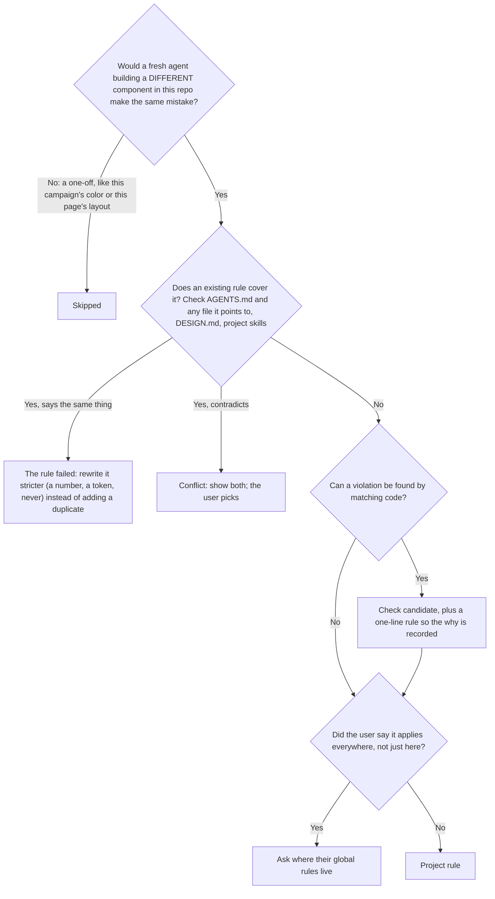

# Learning Taste

## Overview

Every design correction is taste the agent didn't have; unwritten, it repeats next session. Collect the corrections, generalize each to a rule with its reason, and write it into the project's agent instructions file (`AGENTS.md`) where every harness reads it.

## When to Use

- The user explicitly asks to turn this session's (or named sessions') design corrections into lasting rules, or to prune existing design rules.

Not for: making a one-off design fix (just make it), or generating a DESIGN.md from existing code or tokens (use impeccable `document`).

## Hard Rules

1. **Only the user's taste.** Every rule traces back to something the user said, edited, or confirmed. Never add a rule because it seems like good practice. That's your taste, and your taste is what the user was correcting.
2. **Never invent a why.** If the user gave no reason, propose one marked *inferred* and get it confirmed before writing. A wrong why is worse than none: the next agent extends the reasoning to cases it doesn't fit.
3. **Propose, then stop.** Present every candidate and write only what the user approves. A wrong rule repeats in every future session, exactly like the mistake would have.
4. **A check beats a sentence.** If a violation can be found by matching code (a banned value, a raw hex instead of a token, a forbidden property), propose a lint rule, a token restriction, or a test. A check runs every time. A sentence in a long file gets skipped when the agent's context is full.
5. **Write for an agent that wasn't here.** No "like we discussed" or "the card from earlier". Name the class of component, the value, the token, the file.

## Workflow

### Phase 1: Collect corrections

Read the current conversation from the first turn. If the user names earlier sessions and their transcripts are readable on disk (the harness's session logs), read those too.

Explicit corrections are the minority. Look for all five signals:

| Signal | Example | What it tells you |
| --- | --- | --- |
| Explicit correction | "No, semi-transparent shadow, not a border" | The rule, often with the why |
| Silent edit | User changed `duration: 400` to `200` in a file you wrote | Your default was wrong and their value is the rule. Find these through notices that a file changed outside your edits, or by diffing a file against what you last wrote |
| Repeated nudge | "Smaller." → "Still too big." → "Ok" | Your default was off by the total distance. Record where they landed, not the steps |
| Revert or rejection | "Undo that", picking variant B over A, deleting something you added | What not to do. The why is usually missing, so it goes to Phase 3's questions |
| Confirmed non-obvious choice | "Yes, keep the icon outside the button" | A choice a fresh agent might not repeat. Record it only if a fresh agent would plausibly do otherwise |

For each one, capture the user's exact words (or the diff), what you had done, what they wanted instead, and any reason they gave.

Skip what isn't taste: functional bugs, content specific to one screen ("the headline should say Pricing"), and corrections to your understanding of the task.

**Completion criterion:** every turn has been read, and every correction is listed with its source quote or diff.

### Phase 2: Filter

Walk every correction through this decision:



### Phase 3: Generalize and find the why

Pick the narrowest level that would have prevented the mistake on the next, different component:

| Level | Example | Verdict |
| --- | --- | --- |
| Instance | "The pricing card gets a shadow, not a border" | Too narrow: it only protects this card |
| Class | "Raised surfaces (cards, popovers, menus) separate from the background with `shadow-raised`, never a solid border" | Write this |
| Universal | "Never use borders" | Too broad: breaks inputs, dividers, tables |

If the same correction came up on two or more different components, that's evidence for the class level. If two levels both seem right, ask.

Write the rule strictly: values and token names from this codebase, "always" or "never", no "prefer" or "try to". Use softer wording only when the user framed it as a preference.

Then the why. Use the user's reason, in their words, when they gave one. Otherwise write your best candidate, mark it *inferred*, and put it in the questions for the user.

**Self-test before proposing:** read only the rule and its why, then picture the original task. Would an agent that knows nothing else produce what the user wanted? If it could still produce the wrong version, the rule is too vague. Add the value, the token, or the exception.

### Phase 4: Decide where it goes

Rules go in the project's agent instructions file: `AGENTS.md` at the repo root. If the project keeps its agent instructions in another file that every agent it uses already reads, use that one instead; never a harness-specific path.

| Candidate | Where it goes |
| --- | --- |
| Check candidate | Lint rule, token restriction, or test, plus a one-line rule in AGENTS.md |
| "Design rules" section over ~40 lines, or one aspect's rules relevant to only some tasks (motion rules don't matter when building a settings form) | Move that part to DESIGN.md (or a project skill) and leave in AGENTS.md: `Before building or changing UI, read DESIGN.md.` |
| Anything else | AGENTS.md › `## Design rules`, under the matching subsection: Surfaces · Color · Typography · Spacing & layout · Motion · Interaction · Copy |

Create the file, section, or subsection if missing. A rule in a file no agent loads changes nothing: anything moved out of AGENTS.md keeps a pointer there.

DESIGN.md's format belongs to impeccable `document` (the google-labs DESIGN.md spec: token frontmatter, then up to eight canonical sections in a fixed order). Never add a section of your own. If DESIGN.md is missing, create it with impeccable `document` first. Write each moved rule into its canonical section: as a Named Rule (`**The <Name> Rule.** <rule>`) under Colors, Typography, or Elevation & Depth; everything else (spacing, shapes, motion, interaction, copy) as a **Do** / **Don't** bullet in Do's and Don'ts. Keep the why and the provenance comment under each rule. If `.impeccable/design.json` exists, refresh it with impeccable `document` (sidecar only) afterwards; it copies DESIGN.md's rules.

AGENTS.md entry format:

```md
### Surfaces

- **Raised surfaces (cards, popovers, menus) use `shadow-raised`, never a solid border.**
  Why: a solid border makes a raised surface look flat and heavy; a semi-transparent shadow separates it from the background and adapts to both themes.
  <!-- 2026-11-12: "no, semi-transparent shadow, not a border" -->
```

The comment holds the date and the user's words. When a later correction conflicts, it shows which rule is newer and what the user actually said.

### Phase 5: Report

Present the report below (Hard Rule 3).

### Phase 6: Write on approval

Write only the approved items. Show the resulting diff of AGENTS.md (and DESIGN.md, skill, or config file if touched). For a check, implement it and run it across the codebase. Never change component code without asking: if the check flags existing code, report the count and ask whether to make it a warning or fix the violations.

## Required Output Format

### Rules to add

| # | You said | Rule | Why | Where |
| --- | --- | --- | --- | --- |
| 1 | "no, semi-transparent shadow, not a border" | Raised surfaces use `shadow-raised`, never a solid border | Solid borders look flat and heavy; shadows adapt to both themes | AGENTS.md › Design rules › Surfaces |
| 2 | Changed `duration: 400` → `200` in `Dropdown.tsx` | Dropdowns and popovers open in 150–200ms | *inferred:* 400ms felt sluggish on a surface opened many times a day | AGENTS.md › Design rules › Motion |

### Needs your answer

Each *inferred* why, each ambiguous generalization level, and each global-or-project question. One line each, with your recommendation.

### Conflicts

The existing rule, the new correction, and which one you'd keep.

### Make it a check

Each check candidate with its exact implementation (the rule config or test), and what it would flag in the current codebase.

### Skipped

One line per skipped correction and why, so the user can override.

Close with: "Say `write all` or `write 1, 3`, and answer the questions above."

If the session had no taste corrections, say so in one line. That's a good result, not a failure.

## Invocation Variants

| Invocation | Behavior |
| --- | --- |
| learn-taste | Current session, full workflow, stop at the report |
| learn-taste `<sessions>` | Also read the named or most recent N session transcripts |
| `write all` / `write 1, 3` | Write the approved items from the last report |
| learn-taste prune | Read the design rules (AGENTS.md and any DESIGN.md it points to) and propose merges for duplicates, fixes for contradictions, and stricter wording for vague rules (Hard Rule 3) |
