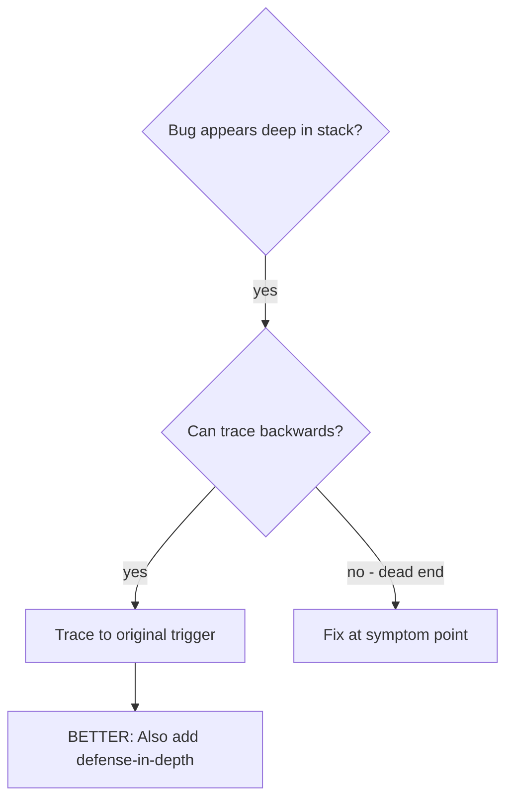

# Root Cause Tracing

## Overview

Bugs often manifest deep in the call stack (git init in wrong directory, file created in wrong location, database opened with wrong path). Your instinct is to fix where the error appears, but that's treating a symptom.

**Core principle:** Trace backward through the call chain until you find the original trigger, then fix at the source.

## When to Use



**Use when:**
- Error happens deep in execution (not at entry point)
- Stack trace shows long call chain
- Unclear where invalid data originated
- Need to find which test/code triggers the problem

## The Tracing Process

### 1. Observe the Symptom
```
Error: git init failed in ~/project/packages/core
```
`.git` was created in `packages/core/`, the source code.

### 2. Find Immediate Cause
**What code directly causes this?**
```typescript
await execFileAsync('git', ['init'], { cwd: projectDir });
```

### 3. Ask: What Called This?
```typescript
WorktreeManager.createSessionWorktree(projectDir, sessionId)
  → called by Session.initializeWorkspace()
  → called by Session.create()
  → called by test at Project.create()
```

### 4. Keep Tracing Up
**What value was passed?**
- `projectDir = ''` (empty string!)
- Empty string as `cwd` resolves to `process.cwd()`
- That's the source code directory!

### 5. Find Original Trigger
**Where did empty string come from?**
```typescript
const context = setupCoreTest(); // Returns { tempDir: '' }
Project.create('name', context.tempDir); // Accessed before beforeEach!
```

**Root cause:** top-level variable initialization read `context.tempDir` before `beforeEach` set it.

### 6. Fix at the Source
Make `tempDir` a getter that throws if accessed before `beforeEach`. Then add validation at each layer the value passed through: [defense-in-depth.md](defense-in-depth.md) shows the four layers added for this bug.

## Adding Stack Traces

When you can't trace manually, add instrumentation:

```typescript
// Before the problematic operation
async function gitInit(directory: string) {
  const stack = new Error().stack;
  console.error('DEBUG git init:', {
    directory,
    cwd: process.cwd(),
    nodeEnv: process.env.NODE_ENV,
    stack,
  });

  await execFileAsync('git', ['init'], { cwd: directory });
}
```

- Use `console.error()` in tests, not a logger: the logger may be suppressed.
- Log before the dangerous operation, not after it fails.
- Include context: directory, cwd, environment variables, timestamps. `new Error().stack` shows the complete call chain.

**Run and capture:**
```bash
bun test 2>&1 | grep 'DEBUG git init'
```

**Analyze stack traces:**
- Look for test file names
- Find the line number triggering the call
- Identify the pattern (same test? same parameter?)

## Finding Which Test Causes Pollution

If something appears during tests but you don't know which test, run `find-polluter.sh` (in this skill's directory) from the project root:

```bash
<skill-dir>/find-polluter.sh '.git' 'src/**/*.test.ts'
TEST_CMD='bunx vitest run' <skill-dir>/find-polluter.sh '.git' 'src/**/*.test.ts'
```

It runs the test files one by one (`TEST_CMD`, default `bun test`) and stops at the first that creates the path. It exits with an error if the path already exists before the first test. See the script header for usage.
