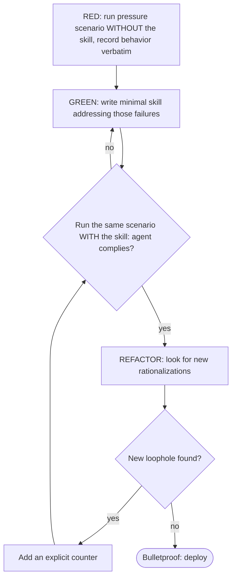

# Writing Skills

## Overview

**The writing standard is `skills/README.md`** (in the nix-config repo): language, frontmatter, body shape, cross-references, flowcharts, environment, third-party provenance, verification and publishing. Read it before writing. This skill adds what the README does not cover: deciding whether a skill is warranted, and testing that it actually changes agent behavior.

**Core principle:** writing a skill is test-driven development applied to process documentation. If you didn't watch an agent fail without the skill, you don't know whether the skill teaches the right thing.

**REQUIRED BACKGROUND:** test-driven-development — it defines the RED-GREEN-REFACTOR cycle this skill adapts.

Skills live in `skills/<name>/` in the nix-config repo and are deployed to `~/.agents/skills/<name>` by `home/jhl/common/core/skills.nix`.

## When to create a skill

**Create when:**
- the technique wasn't intuitively obvious to you;
- you'd reference it again across projects;
- the pattern applies broadly, not to one project;
- others would benefit.

**Don't create for:**
- one-off solutions;
- standard practice already documented elsewhere;
- project-specific conventions — put those in the project's instruction file;
- mechanical constraints — if a regex or validation can enforce it, automate it and keep documentation for judgment calls.

A skill is a reusable technique, pattern, tool or reference guide — never a narrative about how you solved a problem once.

## Skill types

| Type | Example | Test with | Success criterion |
|---|---|---|---|
| **Discipline** (rules an agent skips under pressure) | test-driven-development, verification-before-completion | Academic questions; pressure scenarios; several pressures combined (time + sunk cost + exhaustion) | Agent follows the rule under maximum pressure |
| **Technique** (how-to) | condition-based waiting, root-cause tracing | Application scenarios; variations and edge cases; missing-information tests | Agent applies the technique to a new scenario |
| **Pattern** (mental model) | flatten-with-flags, information hiding | Recognition scenarios; application; counter-examples | Agent knows when and when not to apply it |
| **Reference** (API, commands) | nix-config, office document skills | Retrieval; application; gap testing for common use cases | Agent finds and correctly applies the information |

## TDD mapping

| TDD concept | Skill creation |
|---|---|
| Test case | Pressure scenario run with a subagent |
| Production code | `SKILL.md` |
| Test fails (RED) | Agent violates the rule without the skill (baseline) |
| Test passes (GREEN) | Agent complies with the skill present |
| Refactor | Close loopholes while keeping compliance |
| Write the test first | Run the baseline scenario before writing the skill |
| Watch it fail | Record the agent's exact rationalizations |
| Minimal code | Write only what addresses those violations |

## RED-GREEN-REFACTOR for skills



**RED.** Run the scenario with a subagent that does not have the skill. Record which choices it made, its rationalizations word for word, and which pressures triggered the violation. Read [testing-skills-with-subagents.md](testing-skills-with-subagents.md) for scenario design, pressure types and meta-testing.

**GREEN.** Write the skill against those specific rationalizations; add nothing for hypothetical cases. Re-run the same scenarios with the skill. The agent should now comply.

**REFACTOR.** New rationalization? Add an explicit counter and re-test until the agent complies under combined pressure.

Which skills must go through this: skills/README.md F.3 (discipline skills always; wording changes get micro-tests; pure reference skills are exempt).

## Match the form to the failure

Classify the baseline failure before writing guidance. The form that bulletproofs one failure type backfires on another.

| Baseline failure | Right form | Wrong form |
|---|---|---|
| Skips or violates a rule under pressure (knows better, does it anyway) | Prohibition + red-flags/rationalizations table (see Bulletproofing) | Soft guidance ("prefer...", "consider...") |
| Complies, but the output has the wrong shape (bloated prompt, buried verdict, restated spec) | Positive recipe or contract: state what the output IS — its parts, in order | Prohibition list ("don't restate", "never narrate") |
| Omits a required element from something it already produces | Structural: a REQUIRED field or slot in the template it fills in | Prose reminders near the template |
| Behavior should depend on a condition | A conditional keyed to an observable predicate ("if the brief exists, reference it") | An unconditional rule plus exemption clauses |

**Prohibitions backfire on shaping problems.** Under a competing incentive ("make the prompt self-contained"), agents negotiate with "don't X". In head-to-head wording tests on dispatch-prompt guidance, the prohibition arm produced clearly more of the unwanted content than the recipe arm (fully separated distributions) and trended worse than the no-guidance control. A recipe leaves nothing to negotiate: the output matches the stated shape or it doesn't.

Whichever form you pick:
- **No nuance clauses.** "Don't X unless it matters" reopens the negotiation; one appended nuance clause degraded a winning recipe from consistent to noisy. Express a real exception as its own conditional on an observable predicate.
- **Exemption clauses don't scope.** "This limit doesn't apply to code blocks" still suppresses code blocks. If part of the output must be exempt, restructure so the rule can't reach it.

## Bulletproofing discipline skills

This toolkit is for discipline failures only — an agent that knows the rule and skips it under pressure. For wrong-shaped output or omitted elements it backfires; use the forms above. Background on why it works: [persuasion-principles.md](persuasion-principles.md) (authority, commitment, scarcity, social proof, unity; Cialdini 2021, Meincke et al. 2025).

**Close every loophole explicitly.** Don't only state the rule; forbid the specific workarounds:

```markdown
Write code before test? Delete it. Start over.

**No exceptions:**
- Don't keep it as "reference"
- Don't "adapt" it while writing tests
- Don't look at it
- Delete means delete
```

**Address "spirit vs letter" early:** "Violating the letter of the rules is violating the spirit of the rules." This cuts off a whole class of rationalizations.

**One red-flags/rationalizations table.** Every excuse from baseline testing goes into a single table (skills/README.md C.2 — not again as a separate list):

```markdown
| Thought | Reality |
|---|---|
| "Too simple to test" | Simple code breaks. The test takes 30 seconds. |
| "I'll test after" | Tests passing immediately prove nothing. |
```

**Put violation symptoms in the description** — the moment the agent is about to break the rule: `Use when implementing any feature or bugfix, before writing implementation code.`

## Micro-test wording before full scenarios

Full pressure scenarios are the final gate but slow per iteration. Verify the wording first:

1. **One fresh-context sample per call** — a raw API call or a single-shot subagent. System prompt = the realistic context the guidance lives in (the full skill or prompt template, not the guidance alone); user message = a task that tempts the failure.
2. **Always include a no-guidance control.** If the control doesn't show the failure, there is nothing to fix — don't write the guidance.
3. **5+ runs per variant.** Single samples lie.
4. **Read every flagged match manually.** Template echoes and quoted counter-examples masquerade as hits; automated counts overstate both failure and success.
5. **Variance is a metric.** When guidance lands, runs converge on one shape. Five different interpretations in five runs means the wording isn't binding — tighten the form before adding words.

Micro-tests verify wording; they don't replace pressure scenarios for discipline skills.

## Keeping skills discoverable and cheap

How an agent finds a skill: hits a problem → matches descriptions → reads the overview → scans the quick reference → loads examples only when implementing. Put searchable terms early: error messages ("Hook timed out", "ENOTEMPTY"), symptoms ("flaky", "hanging", "zombie"), synonyms ("timeout/hang/freeze"), tool names.

Frequently loaded skills cost context in every session:
- **Move details to tool help:** "supports multiple modes and filters; run `--help`" instead of documenting every flag.
- **Reference, don't repeat:** name the other skill instead of re-explaining its workflow.
- **Compress examples:** one minimal exchange, not a full transcript.
- **One excellent example** in the most relevant language of skills/README.md D — complete, runnable, from a real scenario, commented on *why*. Not five languages, not a fill-in-the-blank template.

## Rationalizations for skipping testing

| Thought | Reality |
|---|---|
| "The skill is obviously clear" | Clear to you ≠ clear to other agents. Test it. |
| "It's just a reference" | References have gaps and unclear sections. Test retrieval. |
| "Testing is overkill" / "too tedious" | Untested skills have issues, always. 15 minutes of testing saves hours of debugging a bad skill. |
| "I'll test if problems emerge" | Problems mean agents can't use the skill. Test before deploying. |
| "I'm confident it's good" | Overconfidence guarantees issues. |
| "Academic review is enough" | Reading ≠ using. Test application scenarios. |
| "Batching several skills is more efficient" | Each skill is verified before the next one starts. |

## Checklist

Put each item on the todo list.

**RED**
- [ ] Pressure scenarios written (3+ combined pressures for discipline skills)
- [ ] Scenarios run without the skill; baseline behavior recorded verbatim
- [ ] Failure patterns identified and classified (Match the form to the failure)

**GREEN**
- [ ] Skill written to skills/README.md (frontmatter, shape, cross-references, flowcharts)
- [ ] Guidance addresses the recorded baseline failures, in the form matching the failure type
- [ ] Behavior-shaping wording micro-tested against a no-guidance control (5+ runs, every flagged match read) — N/A for pure reference skills
- [ ] Scenarios re-run with the skill; agent complies

**REFACTOR**
- [ ] New rationalizations countered explicitly; table updated
- [ ] Re-tested until compliant under combined pressure

**Deploy** — skills/README.md F and G: line-by-line comparison for edits, `nix eval`, read the generated skill directory, commit and push; for a third-party skill, consider an upstream PR.
